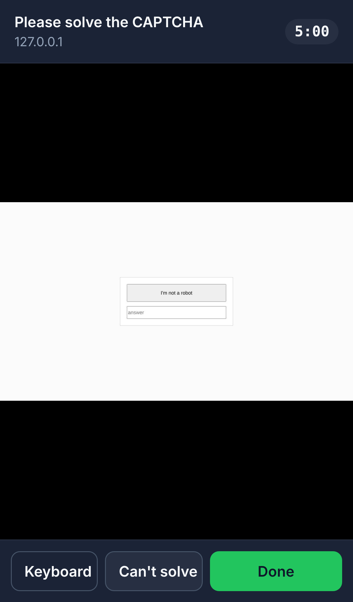

# Unstuck

**Human takeover for AI browser agents.** When your agent gets stuck on a CAPTCHA, a login wall, a 2FA prompt or any page that needs a person, Unstuck pauses the agent, sends the right human a link, lets them take over the live browser from any device, and hands control back.

> Work in progress. See the [MVP design spec](docs/superpowers/specs/2026-11-12-unstuck-mvp-design.md) and [Plan 1](docs/superpowers/plans/2026-11-12-unstuck-plan-1-foundation.md).



## Quickstart (5 minutes, no infrastructure)

Requirements: Node 22, pnpm 10, [Bun](https://bun.sh) (only to compile the engine), and Playwright for the example.

1. Build the engine binary (it embeds the viewer):

```bash
pnpm install
```

```bash
pnpm --filter @unstuck/engine build
```

2. Add one call where your agent gets stuck:

```ts
import { chromium } from 'playwright';
import { Unstuck } from 'unstuck';

const browser = await chromium.launch();
const page = await browser.newPage();
await page.goto('https://www.google.com/recaptcha/api2/demo');

const unstuck = new Unstuck({ onLink: ({ url, reason }) => console.log(`${reason}: ${url}`) });
const result = await unstuck.takeover(page, { reason: 'Please solve the CAPTCHA', timeoutS: 300 });
console.log(result.status); // 'resolved' | 'timed_out' | 'cancelled' | 'failed'
await unstuck.close();
await browser.close();
```

3. Run the bundled example and open the printed link in any browser:

```bash
cd examples/playwright-ts && UNSTUCK_ENGINE_PATH=../../engine/dist/unstuck-engine pnpm start
```

The human sees the live page, taps and types into it (a **Keyboard** button opens the phone keyboard), then taps **Done**. `takeover()` resolves and your agent continues. **Can't solve** hands it back with an optional reason.

By default the viewer is only reachable on `127.0.0.1`. To open the link from a phone, set `UNSTUCK_HOST=0.0.0.0` and `UNSTUCK_PUBLIC_URL=http://<your-lan-ip>:<port>` (the engine warns when it is reachable from your network), or wait for the relay in Plan 3.

### Security model (Plan 1)

- Each link carries a signed, single-use token in the URL fragment, so it never reaches server logs. It expires with the takeover (default 10 minutes).
- Only one person can hold a takeover. A second person opening the link sees "already in use".
- The audit log (`~/.unstuck/events.jsonl`, or `UNSTUCK_LOG`) records states and input counts, never what was typed.

## Develop

```bash
pnpm test
```

Every package keeps test coverage above 90%. The end-to-end suite (`e2e/`) drives a real takeover from an iPhone-sized browser and needs the engine built first.

## Licensing

- SDKs, engine, protocol, MCP server and integrations: [Apache-2.0](LICENSE-APACHE)
- Relay and viewer: [AGPL-3.0](LICENSE-AGPL)

Each package carries its own `LICENSE` file.
