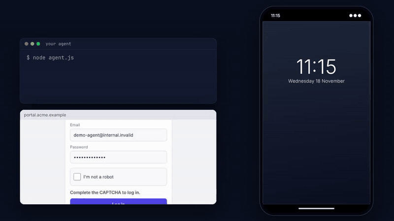
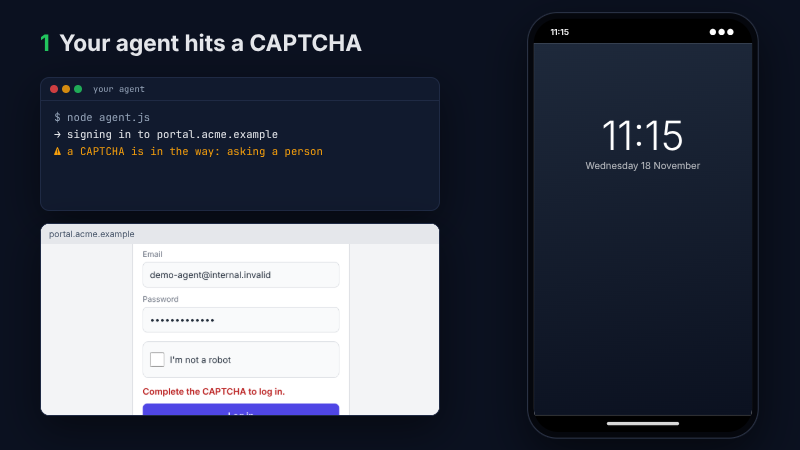
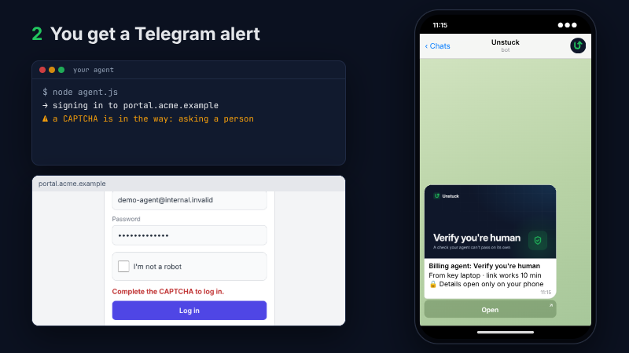
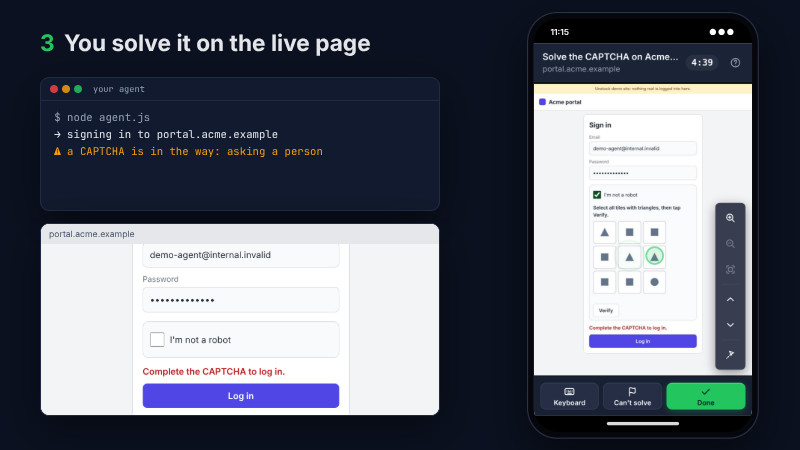
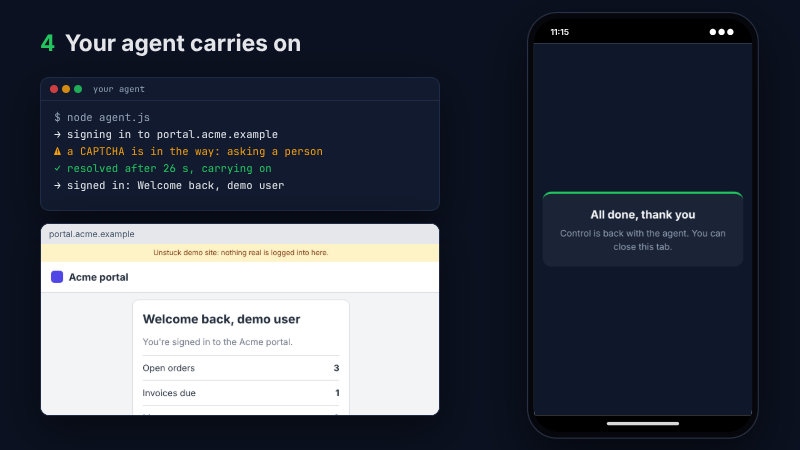

<p align="center">
  
</p>

<h3 align="center">Your AI agent hits a CAPTCHA. You tap your phone. It carries on.</h3>

<p align="center">
  <a href="#-quick-start">Quick start</a> · <a href="https://unstuck.sh/docs/">Docs</a> · <a href="https://unstuck.sh">Try it on your phone</a> · <a href="examples">Examples</a> · <a href="https://unstuck.sh/docs/security/">Security</a>
</p>

<p align="center">
  <a href="https://unstuck.sh/docs/"></a>
</p>

**Unstuck is human takeover for AI browser agents.** When your agent gets stuck on a CAPTCHA, a login wall, a 2FA prompt or any page that needs a person, Unstuck pauses it, sends someone a link, lets them work the live browser from their phone, and hands control back: same page, same cookies, same session.

<p align="center">
  
  
  
  
</p>

Every screen above is the real product, from one recorded run on the demo site. A person solves every check; the site's terms still apply.

## 🚀 Quick start

```bash
npm install @velmlabs/unstuck playwright     # TypeScript, Node.js 20+
pip install unstuck playwright               # Python 3.10+
```

The engine ships inside the package for macOS, Linux and Windows: nothing else to install ([requirements](https://unstuck.sh/docs/requirements/)). Add one call where your agent gets stuck:

```ts
import { Unstuck } from '@velmlabs/unstuck';

const unstuck = new Unstuck({ onLink: ({ url }) => console.log('Open this link:', url) });
const result = await unstuck.takeover(page, { reason: 'Please solve the CAPTCHA' });
if (result.status === 'resolved') {
  // Carry on in the same page, with the same cookies and session.
}
```

<details><summary>The same in Python</summary>

```python
async with Unstuck(on_link=lambda link: print("Open this link:", link.url)) as unstuck:
    result = await unstuck.takeover(page, reason="Please solve the CAPTCHA")
if result.status == "resolved":
    ...  # carry on in the same page
```

</details>

Open the printed link, solve the check, tap **Done**. `takeover()` returns `resolved`, `cancelled` (the person tapped **Can't solve**), `timed_out` or `failed`. Rather not call it yourself? [Unstuck Browser](https://unstuck.sh/docs/browser/) wraps your page once and brings a person in only when a check appears.

## 🧩 Works with

| Your stack | Guide | Example |
|---|---|---|
| Playwright (TypeScript, Python) | [Playwright](https://unstuck.sh/docs/playwright/) | [`playwright-ts`](examples/playwright-ts), [`playwright-py`](examples/playwright-py) |
| Puppeteer | [Puppeteer](https://unstuck.sh/docs/puppeteer/) | [`puppeteer`](examples/puppeteer) |
| browser-use, Stagehand | [AI agents](https://unstuck.sh/docs/ai-agents/) | [`browser-use`](examples/browser-use), [`stagehand`](examples/stagehand) |
| Wrap your page once: rescue only when a check appears | [Unstuck Browser](https://unstuck.sh/docs/browser/) | [`browser-playwright-ts`](examples/browser-playwright-ts), [`browser-playwright-py`](examples/browser-playwright-py) |
| Claude Code, Codex, Cursor, Gemini CLI and other agents (MCP) | [Your AI agent](https://unstuck.sh/docs/agents/), [MCP](https://unstuck.sh/docs/mcp/) | [`mcp`](examples/mcp), [`mcp-browser`](examples/mcp-browser) |
| agent-browser and other shell-driven browsers | [agent-browser](https://unstuck.sh/docs/agent-browser/) | [`agent-browser`](examples/agent-browser) |
| Cloudflare Workers, Durable Objects, Agents SDK | [Cloudflare Workers](https://unstuck.sh/docs/cloudflare-workers/) | [`cloudflare-worker`](examples/cloudflare-worker), [`cloudflare-agent`](examples/cloudflare-agent) |
| Any Chromium over CDP, Selenium, hosted browsers | [Any browser](https://unstuck.sh/docs/any-browser/) | [`cdp`](examples/cdp), [`selenium`](examples/selenium) |

**Claude Code in one line:** `claude mcp add unstuck -- npx -y @velmlabs/unstuck-engine --mcp --open`, or install the [plugin and skill](plugins/unstuck) so the agent knows when to ask.

**Shell agents:** `npm install -g @velmlabs/unstuck-engine`, then `unstuck check`, `unstuck rescue` and `unstuck wait "$(… | jq -r .id)"` after each navigation ([agent-browser guide](https://unstuck.sh/docs/agent-browser/)).

## 📱 How the person gets the link

- **Local, free, no account:** the link opens on the machine your agent runs on (and your local network).
- **Unstuck Cloud:** set `UNSTUCK_API_KEY` (free key at [unstuck.sh](https://unstuck.sh), 100 takeovers a month) and the link opens on any phone, with an alert by Telegram (recommended), phone notification, browser or email ([phone alerts](https://unstuck.sh/docs/alerts/)). Or [self-host the relay](https://unstuck.sh/docs/self-host/).

Beyond CAPTCHAs: [sign-in approvals](https://unstuck.sh/docs/approvals/) finish by themselves once the person approves on their phone, and [questions](https://unstuck.sh/docs/questions/) ask for a decision with no page at all.

## 🔒 Safe to hand to a human

- **End-to-end encrypted:** screen, taps and typing are encrypted between your agent and the phone; the relay passes along data it can't read.
- **Locked to the page:** the tab can't leave the site you handed over, so your browser's other logins stay out of reach.
- **Single-use links:** a one-time token and key in the part of the URL that never reaches a server. One person at a time.
- **Audit log without secrets:** every takeover is logged by state and time; what was typed is never recorded.
- **Open-source viewer:** the page the phone opens is this repository's viewer, served from its own address with published checksums.
- **Time-boxed:** takeovers end on Done, Can't solve or your timeout, and your code always gets a clear status back.

The details (encryption, the viewer's integrity hashes, the 6-digit code, allowed sites): [Security](https://unstuck.sh/docs/security/).

## 🧭 Your goal → start here

| Your goal | Start here |
|---|---|
| A first takeover in two minutes | [Quickstart](https://unstuck.sh/docs/quickstart/) |
| Bring a person in only when a check appears | [Unstuck Browser](https://unstuck.sh/docs/browser/) |
| Give Claude Code or another AI agent a "get a human" tool | [Your AI agent](https://unstuck.sh/docs/agents/) and the [agent skill](https://unstuck.sh/docs/skill/) |
| Drive the browser from the shell | [agent-browser](https://unstuck.sh/docs/agent-browser/) |
| Get alerts on your phone | [Phone alerts](https://unstuck.sh/docs/alerts/) |
| Ask the person a question | [Questions](https://unstuck.sh/docs/questions/) |
| Run inside a Cloudflare Worker | [Cloudflare Workers](https://unstuck.sh/docs/cloudflare-workers/) |
| Know exactly what the person can reach | [Security](https://unstuck.sh/docs/security/) |

## Why I built it

One of my scrapers only collected the newest tech news, and sites kept flagging it as a robot. Solving the CAPTCHA myself was fine; getting to it was the problem. So Unstuck hands me the live page when the crawler hits a check it can't pass: a real person answers it, and the crawler carries on.

## Develop

You need Node.js 22+, pnpm 10, [Bun](https://bun.sh) (to build the engine) and [uv](https://docs.astral.sh/uv/) (for the Python SDK's tests).

```bash
pnpm install
pnpm test
pnpm --filter @velmlabs/unstuck-engine build
pnpm e2e:examples
```

Every package keeps test coverage above 90%. `pnpm e2e:examples` runs each example against a real browser and a simulated person on a phone.

## License

- SDKs, engine, viewer, protocol, MCP server and integrations: [Apache-2.0](LICENSE-APACHE). Everything you install from npm or PyPI is Apache-2.0.
- Relay (`relay-core`, `relay-node`, `relay-cloudflare`): [AGPL-3.0](LICENSE-AGPL). It matters only if you run your own relay: if you change it and offer it to others, share your changes.
