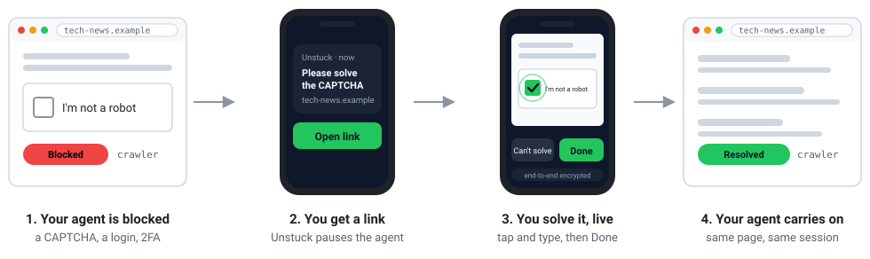

# Unstuck

**Human takeover for AI browser agents.** When your agent gets stuck on a CAPTCHA, a login wall, a 2FA prompt or any page that needs a person, Unstuck pauses it, sends someone a link, lets them work the live browser from their phone, and hands control back.

<p align="center">
  
</p>

## Why I built it

I was playing with web scrapers, curious how far today's tools could go. One of mine only collected the newest tech news so I could post about it on social media. Sites kept flagging it as a robot anyway, and every CAPTCHA stopped it cold.

Solving the CAPTCHA myself was fine; the problem was getting to it. So I built Unstuck: when the crawler hits a check it can't pass, it hands the live page to me, I approve it as the human I am, and the crawler carries on. A real person answers the check, so the site gets exactly what it asked for.

## Get started: your agent meets a CAPTCHA

### 1. Install

```bash
npm install @velmlabs/unstuck playwright     # TypeScript, Node.js 20+
npx playwright install chromium
```

```bash
pip install unstuck playwright               # Python 3.10+
python -m playwright install chromium
```

The engine ships inside the package for macOS (Apple silicon and Intel), Linux and Windows, so there is nothing else to install. Unstuck drives Chromium-based browsers ([requirements](https://unstuck.sh/docs/requirements/)).

### 2. Add one call where your agent gets stuck

Your agent browses as usual. When it lands on a CAPTCHA, it asks for help and waits:

```ts
import { chromium } from 'playwright';
import { Unstuck } from '@velmlabs/unstuck';

const browser = await chromium.launch();
const page = await browser.newPage();
await page.goto('https://www.google.com/recaptcha/api2/demo'); // a page with a CAPTCHA

const unstuck = new Unstuck({ onLink: ({ url }) => console.log('Open this link:', url) });
const result = await unstuck.takeover(page, { reason: 'Please solve the CAPTCHA' });

if (result.status === 'resolved') {
  // The CAPTCHA is solved: carry on in the same page, with the same cookies and session.
}
```

<details><summary>The same in Python</summary>

```python
async with Unstuck(on_link=lambda link: print("Open this link:", link.url)) as unstuck:
    result = await unstuck.takeover(page, reason="Please solve the CAPTCHA")
if result.status == "resolved":
    ...  # carry on in the same page
```

</details>

`takeover()` returns `resolved`, `cancelled` (the person tapped **Can't solve**), `timed_out` or `failed`.

### 3. Solve it from your phone

Run your agent and open the printed link. You see the agent's live page: tap the checkbox, pick the images, type a code, then tap **Done**. The agent picks up where it stopped.

By default the link opens only on the machine your agent runs on. To get it on your phone, from anywhere, create a free API key at [unstuck.sh](https://unstuck.sh) (100 takeovers a month) and set it:

```bash
export UNSTUCK_API_KEY=uk_live_…
```

Nothing else in your code changes. The whole quickstart, with every option: [unstuck.sh/docs/quickstart](https://unstuck.sh/docs/quickstart/).

<p align="center">
  
  &nbsp;&nbsp;
  
</p>

### Using Claude Code, Cursor or another AI agent?

Give it a `request_human_takeover` tool. Start Chrome with a debugging port, then add Unstuck as an MCP server:

```bash
claude mcp add unstuck -e UNSTUCK_CDP_URL=http://127.0.0.1:9222 -- npx -y @velmlabs/unstuck-engine --mcp --open
```

Tell your agent: *"If you hit a CAPTCHA or a login, call request_human_takeover with the reason."* Setup for Claude Desktop and Cursor: [unstuck.sh/docs/mcp](https://unstuck.sh/docs/mcp/).

## Works with

| Stack | Guide | Example |
|---|---|---|
| MCP: Claude Code, Claude Desktop, Cursor, Playwright MCP | [unstuck.sh/docs/mcp](https://unstuck.sh/docs/mcp) | [`examples/mcp`](examples/mcp) |
| Playwright (TypeScript, Python) | [unstuck.sh/docs/playwright](https://unstuck.sh/docs/playwright) | [`examples/playwright-ts`](examples/playwright-ts), [`examples/playwright-py`](examples/playwright-py) |
| Puppeteer | [unstuck.sh/docs/puppeteer](https://unstuck.sh/docs/puppeteer) | [`examples/puppeteer`](examples/puppeteer) |
| browser-use, Stagehand | [unstuck.sh/docs/ai-agents](https://unstuck.sh/docs/ai-agents) | [`examples/browser-use`](examples/browser-use), [`examples/stagehand`](examples/stagehand) |
| Any Chromium over CDP, Selenium, hosted browsers | [unstuck.sh/docs/any-browser](https://unstuck.sh/docs/any-browser) | [`examples/cdp`](examples/cdp), [`examples/selenium`](examples/selenium) |

Full docs: **https://unstuck.sh/docs**

## Local or Unstuck Cloud

| | Where the link works | Set |
|---|---|---|
| Local (default) | on the agent's own machine | nothing |
| [Unstuck Cloud](https://unstuck.sh) (100 free takeovers a month) | any phone, from anywhere | `UNSTUCK_API_KEY=uk_live_…` |
| Your own relay | wherever you host it | `UNSTUCK_RELAY_URL` and `UNSTUCK_AGENT_KEY` |

Run your own relay on Node or Docker (`relay-node/`) or on Cloudflare Workers (`relay-cloudflare/`).

## Security

- Each link carries a single-use token and a fresh encryption key in the URL fragment, which never reaches a server or log.
- The screen, taps and keystrokes are encrypted end to end (AES-GCM) between your agent's engine and the person's browser. A relay, Unstuck Cloud included, only sees ciphertext.
- One person at a time; an optional 6-digit code means a forwarded link alone isn't enough.
- The person can only use the page they were handed. The tab stays on the page's own site (example.com and its subdomains), so the agent browser's other logins are out of reach: links to other sites don't open, new tabs and windows can't be opened, and downloads are blocked. If the flow needs another site, such as a Google sign-in or a bank's 3-D Secure page, list it: `allowedSites: ['accounts.google.com']` (Python: `allowed_sites=[...]`, MCP: `allowed_sites`).
- The audit log records states and input counts, never what was typed.

## Develop

You need Node.js 22+, pnpm 10, [Bun](https://bun.sh) (to build the engine) and [uv](https://docs.astral.sh/uv/) (for the Python SDK's tests).

```bash
pnpm install
pnpm test
pnpm --filter @velmlabs/unstuck-engine build
pnpm e2e:examples
```

Every package keeps test coverage above 90%. `pnpm e2e:examples` runs each example against a real browser and a simulated person on a phone.

## License

- SDKs, engine, viewer, protocol, MCP server and integrations: [Apache-2.0](LICENSE-APACHE). Everything you install from npm or PyPI is Apache-2.0.
- Relay (`relay-core`, `relay-node`, `relay-cloudflare`): [AGPL-3.0](LICENSE-AGPL). It matters only if you run your own relay: if you change it and offer it to others, share your changes.
