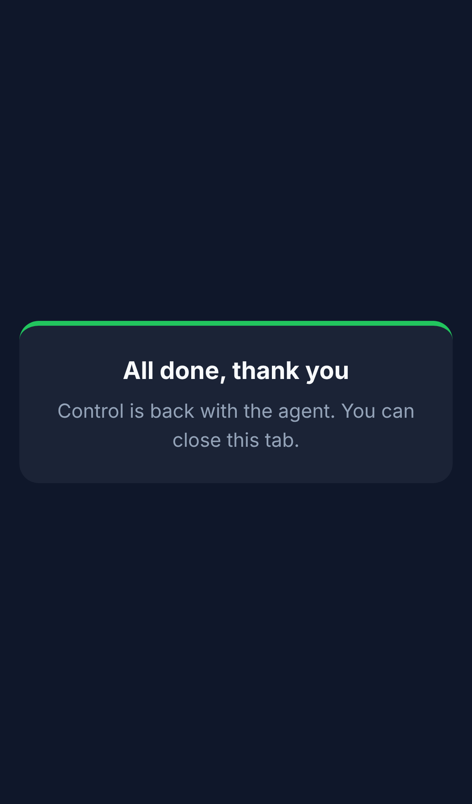

<p align="center">
  
</p>

# Unstuck

**Human takeover for AI browser agents.** When your agent gets stuck on a CAPTCHA, a login wall, a 2FA prompt or any page that needs a person, Unstuck pauses it, sends someone a link, lets them work the live browser from their phone, and hands control back.

<p align="center">
  
</p>

## Why I built it

I was playing with web scrapers, curious how far today's tools could go. One of mine only collected the newest tech news so I could post about it on social media. Sites kept flagging it as a robot anyway, and every CAPTCHA stopped it cold.

Solving the CAPTCHA myself was fine; the problem was getting to it. So I built Unstuck: when the crawler hits a check it can't pass, it hands the live page to me, I approve it as the human I am, and the crawler carries on. A real person answers the check, so the site gets exactly what it asked for.

## Get started: your agent meets a CAPTCHA

### 1. Install

```bash
npm install @velmlabs/unstuck playwright     # TypeScript, Node.js 20+
npx playwright install chromium
```

```bash
pip install unstuck playwright               # Python 3.10+
python -m playwright install chromium
```

The engine ships inside the package for macOS (Apple silicon and Intel), Linux and Windows, so there is nothing else to install. Unstuck drives Chromium-based browsers ([requirements](https://unstuck.sh/docs/requirements/)).

### 2. Add one call where your agent gets stuck

Your agent browses as usual. When it lands on a CAPTCHA, it asks for help and waits:

```ts
import { chromium } from 'playwright';
import { Unstuck } from '@velmlabs/unstuck';

const browser = await chromium.launch();
const page = await browser.newPage();
await page.goto('https://www.google.com/recaptcha/api2/demo'); // a page with a CAPTCHA

const unstuck = new Unstuck({ onLink: ({ url }) => console.log('Open this link:', url) });
const result = await unstuck.takeover(page, { reason: 'Please solve the CAPTCHA' });

if (result.status === 'resolved') {
  // The CAPTCHA is solved: carry on in the same page, with the same cookies and session.
}
```

<details><summary>The same in Python</summary>

```python
async with Unstuck(on_link=lambda link: print("Open this link:", link.url)) as unstuck:
    result = await unstuck.takeover(page, reason="Please solve the CAPTCHA")
if result.status == "resolved":
    ...  # carry on in the same page
```

</details>

`takeover()` returns `resolved`, `cancelled` (the person tapped **Can't solve**), `timed_out` or `failed`.

### 3. Solve it from your phone

Run your agent and open the printed link. You see the agent's live page: tap the checkbox, pick the images, type a code, then tap **Done**. The agent picks up where it stopped.

By default the link opens only on the machine your agent runs on. To get it on your phone, from anywhere, create a free API key at [unstuck.sh](https://unstuck.sh) (100 takeovers a month) and set it:

```bash
export UNSTUCK_API_KEY=uk_live_…
```

Nothing else in your code changes. The whole quickstart, with every option: [unstuck.sh/docs/quickstart](https://unstuck.sh/docs/quickstart/).

<p align="center">
  
  &nbsp;&nbsp;
  
</p>

### Using Claude Code, Cursor or another AI agent?

Give it a `request_human_takeover` tool (or the two-step `start_human_takeover`, below). Start Chrome with a debugging port, then add Unstuck as an MCP server:

```bash
claude mcp add unstuck -e UNSTUCK_CDP_URL=http://127.0.0.1:9222 -- npx -y @velmlabs/unstuck-engine --mcp --open
```

Tell your agent: *"If you hit a CAPTCHA or a login, call request_human_takeover with the reason."* Setup for Claude Desktop and Cursor: [unstuck.sh/docs/mcp](https://unstuck.sh/docs/mcp/).

**No phone alerts? Let the agent show you the link.** The server also has a two-step flow: `start_human_takeover` returns the link at once, the agent shows it in the chat, and `wait_for_human_takeover` picks up the result after you tap Done. Open the link yourself or forward it to whoever will solve the step (WhatsApp, Slack…): previews connect nothing until someone taps Start, the link works on one device, and it dies when the takeover ends. Share it only with that person. Tell your agent: *"If you hit a CAPTCHA or a login, call start_human_takeover and show me the link."* Without `UNSTUCK_API_KEY` (or your own relay) the link opens only on the agent's computer.

### Give your agent the Unstuck skill

The skill teaches an agent *when* to hand a step to a person (CAPTCHAs, logins, 2FA, pages it can't get past) and *how*: a short reason without secrets, the right timeout and sites, and what to do with each result. You don't have to explain Unstuck in every prompt.

**Claude Code:** install the plugin. It adds the skill and the Unstuck MCP server in one step:

```bash
/plugin marketplace add velmlabs/unstuck
/plugin install unstuck@unstuck
```

Start Chrome with `--remote-debugging-port=9222` as above, then ask for the task: *"Open portal.example.com and download this month's invoice."* At the login or CAPTCHA, the agent calls Unstuck, you get the link, and it carries on after you tap Done.

**Any agent that reads skills** (Codex, Cursor, Claude Desktop and others): download [`SKILL.md`](plugins/unstuck/skills/unstuck/SKILL.md) into its skills folder, and add the MCP server above or the SDK:

```bash
mkdir -p ~/.claude/skills/unstuck
curl -fsSL https://unstuck.sh/skills/unstuck/SKILL.md -o ~/.claude/skills/unstuck/SKILL.md
```

Set `UNSTUCK_API_KEY` (from [your dashboard](https://unstuck.sh/dashboard/keys)) for links that open on any phone and for phone alerts. Full guide: [unstuck.sh/docs/skill](https://unstuck.sh/docs/skill/).

## Works with

| Stack | Guide | Example |
|---|---|---|
| MCP: Claude Code, Claude Desktop, Cursor, Playwright MCP | [unstuck.sh/docs/mcp](https://unstuck.sh/docs/mcp) | [`examples/mcp`](examples/mcp) |
| Agent skill: Claude Code plugin, or any agent that reads skills | [unstuck.sh/docs/skill](https://unstuck.sh/docs/skill/) | [`plugins/unstuck`](plugins/unstuck) |
| Playwright (TypeScript, Python) | [unstuck.sh/docs/playwright](https://unstuck.sh/docs/playwright) | [`examples/playwright-ts`](examples/playwright-ts), [`examples/playwright-py`](examples/playwright-py) |
| Puppeteer | [unstuck.sh/docs/puppeteer](https://unstuck.sh/docs/puppeteer) | [`examples/puppeteer`](examples/puppeteer) |
| browser-use, Stagehand | [unstuck.sh/docs/ai-agents](https://unstuck.sh/docs/ai-agents) | [`examples/browser-use`](examples/browser-use), [`examples/stagehand`](examples/stagehand) |
| Any Chromium over CDP, Selenium, hosted browsers | [unstuck.sh/docs/any-browser](https://unstuck.sh/docs/any-browser) | [`examples/cdp`](examples/cdp), [`examples/selenium`](examples/selenium) |
| Cloudflare Workers: Durable Objects, Agents SDK, Browser Rendering | [unstuck.sh/docs/cloudflare-workers](https://unstuck.sh/docs/cloudflare-workers/) | [`examples/cloudflare-worker`](examples/cloudflare-worker), [`examples/cloudflare-agent`](examples/cloudflare-agent) |
| Deno and Bun (binary mode, or opt in with `mode: 'in-process'`) | [unstuck.sh/docs/requirements](https://unstuck.sh/docs/requirements/) | |

### Cloudflare Workers

Since 0.2.0 the TypeScript SDK runs inside a Worker. It needs a relay, so use an Unstuck Cloud key (or your own relay with `relay` and `agentKey`). Unstuck itself needs no Node compatibility flag, but `@cloudflare/puppeteer` does: keep `compatibility_flags = ["nodejs_compat"]`, as Cloudflare's Browser Rendering guide says.

```bash
npm install @velmlabs/unstuck @cloudflare/puppeteer
npx wrangler secret put UNSTUCK_API_KEY
```

Run the takeover in a Durable Object, which can stay alive while a person works. Start it and answer at once; don't hold the caller's request open:

```ts
import puppeteer from '@cloudflare/puppeteer';
import { Unstuck } from '@velmlabs/unstuck';
import { DurableObject } from 'cloudflare:workers';

interface Env {
  BROWSER: Fetcher;
  UNSTUCK_API_KEY: string;
}

const TIMEOUT_S = 900;

export class PortalAgent extends DurableObject<Env> {
  async fetch(): Promise<Response> {
    const startedAt = await this.ctx.storage.get<number>('startedAt');
    // A run older than its timeout + 2 minutes is stale: the object was evicted mid-run and never reached `finally`.
    if (startedAt === undefined || Date.now() - startedAt > (TIMEOUT_S + 120) * 1000) {
      await this.ctx.storage.put('startedAt', Date.now());
      this.ctx.waitUntil(this.run()); // returns at once; the takeover runs on
    }
    return new Response('started', { status: 202 });
  }

  async run(): Promise<void> {
    let browser: Awaited<ReturnType<typeof puppeteer.launch>> | undefined;
    try {
      browser = await puppeteer.launch(this.env.BROWSER, { keep_alive: 1_200_000 });
      const page = await browser.newPage();
      await page.goto('https://portal.example.com/login');

      const unstuck = new Unstuck({ apiKey: this.env.UNSTUCK_API_KEY });
      const result = await unstuck.takeover(page, {
        reason: 'Log in with your 2FA code',
        timeoutS: TIMEOUT_S,
        alerts: 'required', // fail at once if Unstuck Cloud can't accept the link for at least one paired phone
      });
      await this.ctx.storage.put('result', { status: result.status, detail: result.detail });
    } finally {
      await this.ctx.storage.delete('startedAt');
      await browser?.close();
    }
  }
}
```

A Durable Object stays alive while the takeover holds its sockets open; `ctx.waitUntil` is there for clarity, and an alarm is a sturdier trigger if you need retries.

Without an `onLink`, the link goes to your paired phones and the Worker logs one line naming them (no link). The link itself is logged with `console.log` only when no phone got it, or when there is no phone alert (a relay you host, or `alerts: false`). Workers Logs show a Durable Object's logs only when its invocation ends, which is after the takeover, so for a relay you host pass an `onLink` that sends the link at once (the examples post it to `LINK_WEBHOOK_URL`). A relay on the same Cloudflare account needs the `global_fetch_strictly_public` compatibility flag (else error 1042).

Two deployable examples, each with a **Deploy to Cloudflare** button: [`examples/cloudflare-worker`](examples/cloudflare-worker) (this Durable Object, with `/start` and `/status`) and [`examples/cloudflare-agent`](examples/cloudflare-agent) (the same flow with the Agents SDK).

The full guide (status endpoint, Workflows, timeouts, CPU limits, a self-hosted relay): [unstuck.sh/docs/cloudflare-workers](https://unstuck.sh/docs/cloudflare-workers/).

Full docs: **https://unstuck.sh/docs**

## Local or Unstuck Cloud

| | Where the link works | Set |
|---|---|---|
| Local (default) | on the agent's own machine | nothing |
| [Unstuck Cloud](https://unstuck.sh) (100 free takeovers a month) | any phone, from anywhere | `UNSTUCK_API_KEY=uk_live_…` |
| Your own relay | wherever you host it | `UNSTUCK_RELAY_URL` and `UNSTUCK_AGENT_KEY` |

### Self-host the relay

Everything that makes a takeover work is open source, the relay included. Run it on your own server and links open on any phone with no Unstuck account:

```bash
KEY=$(openssl rand -hex 24) && echo "agent key: $KEY"   # keep it: your agents need it
docker run -d -p 127.0.0.1:8787:8787 -e UNSTUCK_AGENT_KEYS="$KEY" ghcr.io/velmlabs/unstuck-relay:latest
```

The image (`linux/amd64` and `linux/arm64`) is built from this repository by GitHub Actions, with signed provenance: `gh attestation verify oci://ghcr.io/velmlabs/unstuck-relay:latest --owner velmlabs`. To build it yourself: `docker build -f relay-node/Dockerfile -t unstuck-relay .`

Put it behind HTTPS (phones only decrypt the screen on `https://` pages; with Caddy it's `reverse_proxy 127.0.0.1:8787`), then point agents at it:

```bash
export UNSTUCK_RELAY_URL=wss://relay.example.com
export UNSTUCK_AGENT_KEY=<the agent key>
```

It also runs on plain Node (`relay-node/`) and on Cloudflare Workers (`relay-cloudflare/`). Full guide, settings and a comparison with Unstuck Cloud: **[unstuck.sh/docs/self-host](https://unstuck.sh/docs/self-host/)**. Unstuck Cloud is the hosted relay, plus phone alerts and a dashboard, for when you'd rather not run a server.

## Security

- Each link carries a single-use token and a fresh encryption key in the URL fragment, which never reaches a server or log.
- The screen, taps and keystrokes are encrypted end to end (AES-GCM) between your agent's engine and the person's browser. A relay, Unstuck Cloud included, only sees ciphertext, padded so message sizes don't reveal what was typed. It can't replay old messages or silently drop keystrokes.
- With Unstuck Cloud, the page the person opens doesn't come from the relay. Your engine links to a viewer on its own origin (`view.unstuck.sh/v/<engine version>/`), with an integrity hash on every script and a published `SHA256SUMS.json` you can compare against this repository's build. So the relay can't swap in code that reads the key. A self-hosted relay serves the viewer itself; set `UNSTUCK_VIEWER_URL` to use a separately hosted one.
- One person at a time; an optional 6-digit code means a forwarded link alone isn't enough.
- The person can only use the page they were handed. The tab stays on the page's own site (example.com and its subdomains), so the agent browser's other logins are out of reach: links to other sites don't open, and a tab the page opens on another site is closed before the person sees it (its first page load still reaches that site). If the flow needs another site, such as a Google sign-in or a bank's 3-D Secure page, list it: `allowedSites: ['accounts.google.com']` (Python: `allowed_sites=[...]`, MCP: `allowed_sites`).
- Control ends the moment the person taps Done or Can't solve, or the takeover times out or is cancelled: input still queued is discarded, a mouse button they were holding is released, and only then is the page lock removed and the page handed back to the agent. At most 256 inputs wait at a time (pointer moves and scrolls are dropped first).
- With Unstuck Cloud, your engine can also send the link to your paired phones as a Telegram, push or email alert. Telegram is the recommended channel: it arrives reliably, while some phones (many Android ones) hold browser push back to save battery. The link is sealed on your machine to each phone's own key, so Unstuck Cloud only relays ciphertext and never sees the token or key. Turn it off per takeover with `alerts: false` (Python: `alerts=False`, MCP: `alerts: false`); the API key must have alerts enabled. With `alerts: 'required'` (Python: `alerts="required"`) a takeover ends at once as `failed` with detail `alert_failed` if Unstuck Cloud can't accept its link for at least one paired phone, instead of waiting for its timeout.
- The audit log records states and input counts, never what was typed.

## Develop

You need Node.js 22+, pnpm 10, [Bun](https://bun.sh) (to build the engine) and [uv](https://docs.astral.sh/uv/) (for the Python SDK's tests).

```bash
pnpm install
pnpm test
pnpm --filter @velmlabs/unstuck-engine build
pnpm e2e:examples
```

Every package keeps test coverage above 90%. `pnpm e2e:examples` runs each example against a real browser and a simulated person on a phone.

## License

- SDKs, engine, viewer, protocol, MCP server and integrations: [Apache-2.0](LICENSE-APACHE). Everything you install from npm or PyPI is Apache-2.0.
- Relay (`relay-core`, `relay-node`, `relay-cloudflare`): [AGPL-3.0](LICENSE-AGPL). It matters only if you run your own relay: if you change it and offer it to others, share your changes.
